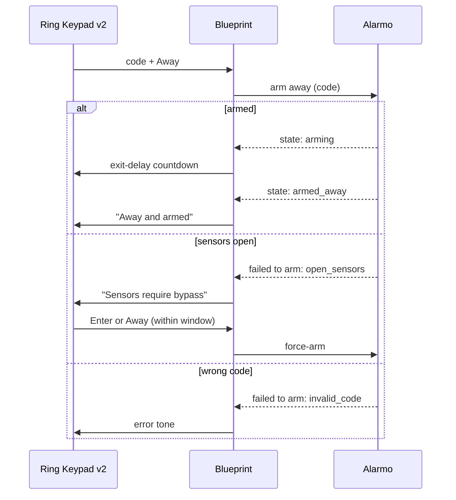

# Ring Keypad v2 + Alarmo

[](https://my.home-assistant.io/redirect/blueprint_import/?blueprint_url=https%3A%2F%2Fgithub.com%2Fevancauteren%2Fring-keypad-alarmo-blueprint%2Fblob%2Fmain%2Fblueprints%2Fautomation%2Fring_keypad_v2%2Fring_keypad_v2_alarmo.yaml)

[](https://github.com/evancauteren/ring-keypad-alarmo-blueprint/releases)


A Home Assistant blueprint that turns a **Ring Alarm Keypad v2** (Z-Wave JS)
into the control panel for **[Alarmo](https://github.com/nielsfaber/alarmo)**.
Arm and disarm from the keypad, and the keypad's LEDs, voice prompts,
countdowns and siren follow Alarmo, whether you arm from the keypad, a
dashboard or an automation.

## Features

- **Arm and disarm** with your Alarmo codes: Away, Home and Disarm keys.
- **Entry and exit countdowns** on the light bar, sized from Alarmo's delays.
- **Sensor bypass.** If a door is open, the keypad says "Sensors require
  bypass". Press Enter or Arm again within a window you choose to force-arm,
  or Disarm/Cancel to give up.
- **Clear panic alerts.** Fire, Police and Medical (held) run your own actions;
  Disarm or Cancel clears them from the keypad, code-gated by default.
- **Cancel key** stops a running countdown.
- **Switch modes without disarming**, e.g. Home → Away. How far this goes is
  configurable.
- **Every Alarmo mode shown.** Night and Custom bypass light the Home LED,
  Vacation lights Away.
- **Error tones** for a wrong code, an arm mode that isn't enabled, and so on,
  only for *your* Alarmo panel.
- **Recovers after a restart.** The mode LED is re-asserted about a minute
  after Home Assistant starts, silently where the firmware allows it.
- **Compatible with older Z-Wave JS** through a selectable countdown format.

## Requirements

- Home Assistant **2024.10** or newer
- A **Ring Alarm Keypad v2**, paired with **Z-Wave JS** (S2 security; use
  SmartStart)
- **Alarmo v1.10.9** or newer

## Installation

Click the **Import Blueprint** badge above, or paste this URL into
**Settings → Automations & scenes → Blueprints → Import blueprint**:

```
https://github.com/evancauteren/ring-keypad-alarmo-blueprint/blob/main/blueprints/automation/ring_keypad_v2/ring_keypad_v2_alarmo.yaml
```

Then **Create automation** from it and pick your keypad and your Alarmo entity.
Everything else has a working default.

<details>
<summary>Manual install</summary>

Copy
[`ring_keypad_v2_alarmo.yaml`](blueprints/automation/ring_keypad_v2/ring_keypad_v2_alarmo.yaml)
to `config/blueprints/automation/ring_keypad_v2/ring_keypad_v2_alarmo.yaml`,
then run **Developer tools → YAML → Reload blueprints**.

</details>

## Configuration

Only **Devices** is required. The other sections are collapsed and have
defaults.

| Section | Option | Default |
|---|---|---|
| **Devices** | Keypad device, Alarm control panel | — |
| **Behaviour** | Bypass confirmation window | 30 s |
| | Require a code to clear a panic alert | On |
| | Switching arm modes from the keypad | To a stricter mode only |
| | Entry/exit delay indicator format | Modern (`timeout`) |
| **Volume recovery** | Re-assert announcement volume after an alarm | Off |
| **State re-sync** | Re-sync after Home Assistant restarts | On |
| | Also re-sync every N hours | 0 (off) |
| | Re-sync silently | On |
| **Panic button actions** | Police / Fire / Medical held, Panic alert cleared | None |

### Volume, brightness and language

These are Z-Wave settings on the keypad itself, not part of the automation.
Set them once in **Settings → Devices & services → Z-Wave JS → your keypad →
Configure device**:

| Parameter | What it does | Range |
|---|---|---|
| 4 | Announcement volume | 0–10 (default 7) |
| 5 | Key tone volume | 0–10 (default 6) |
| 6 | Siren volume | 0–10 (default 10) |
| 7 | Hold time for Fire / Police / Medical | 2–5 s (default 3) |
| 12 | Brightness: mode LEDs | 0–100 % |
| 13 | Brightness: key backlight | 0–100 % |
| 18 | Language (English / French / Spanish) | — |
| 22 | Mode LED: off except on activity, blinking, or always on | 0–601 (default 0) |

All parameters are in [`docs/keypad-reference.md`](docs/keypad-reference.md).

## How it works



**Keypad → Alarmo**

| You press | What happens |
|---|---|
| Code + **Away** / **Home** | Arms that mode, or switches to it if already armed (per your setting) |
| Code + **Disarm**, **Cancel** or **Enter** while armed or counting down | Disarms |
| **Disarm** / **Cancel** while disarmed | Clears a panic alert (needs a code by default) |
| **Fire** / **Police** / **Medical**, held until the lights go out | Runs your action for that button |

**Alarmo → keypad**

| Alarmo state | Keypad |
|---|---|
| `disarmed` | Disarmed LED, "Disarmed" |
| `arming` | Exit delay countdown |
| `pending` | Entry delay countdown |
| `armed_away`, `armed_vacation` | Away LED, "Away and armed" |
| `armed_home`, `armed_night`, `armed_custom_bypass` | Home LED, "Home and armed" |
| `triggered` | Siren |

## Updating

Home Assistant doesn't notify you about blueprint updates. To hear about new
versions, **Watch → Custom → Releases** on this repository.

- **Which version am I on?** The version is in the blueprint's name under
  **Settings → Automations & scenes → Blueprints**, e.g.
  `Ring Keypad v2 + Alarmo (v1.2.1)`.
- **To update:** ⋮ next to the blueprint → **Re-import blueprint**. Your
  automation keeps its settings, and new options take their defaults.
- Release notes are on the
  [Releases](https://github.com/evancauteren/ring-keypad-alarmo-blueprint/releases)
  page. Any release that needs you to check your settings says so.

## Known limitations

- **One keypad per automation.** You can create one automation per keypad, but
  error tones and bypass prompts will sound on every keypad tied to the same
  Alarmo panel. For a true multi-keypad setup, see bharvey88's
  [multi-keypad blueprint](https://github.com/ImSorryButWho/HomeAssistantNotes/pull/49).
- **No Night key.** The keypad has three mode keys. Night, Vacation and Custom
  bypass can be armed from Home Assistant and are shown on the keypad, but
  cannot be armed from it.
- **The mode LED is dark most of the time.** That's the keypad's default
  (parameter 22), not a sync problem. See
  [keypad-reference.md](docs/keypad-reference.md#the-mode-led-is-off--did-the-sync-break).
- **Panic alert cleared** also runs if you press Disarm + code while already
  disarmed with no alert active. Keep that action safe to repeat, e.g. "turn
  the siren off".
- **Silent re-sync** works on the firmware tested so far but isn't guaranteed.
  If the mode LED never updates after a restart, turn **Re-sync silently**
  off. Leave the N-hourly re-sync off until you've confirmed silence, or it
  may announce itself at midnight.
- **Traces are disabled** (`stored_traces: 0`) on purpose: a trace would store
  the PIN typed on the keypad in plain text in `.storage`.

## Troubleshooting

[`docs/testing.md`](docs/testing.md) is a full test plan, about 40 checks
across arming, countdowns, bypass, panic buttons, the siren and restarts. For
each one it says what to expect and where to look when it fails.

The most common issue: arming announces itself but the light bar never counts.
Switch **Entry/exit delay indicator format** to *Legacy*.

## Contributing

Bug reports and pull requests are welcome. Please read
[CONTRIBUTING.md](CONTRIBUTING.md) first: the scope is deliberately narrow
(one keypad, Alarmo).

## Credits & license

Based on [ImSorryButWho](https://github.com/ImSorryButWho/HomeAssistantNotes)'s
original Ring Keypad v2 blueprint and Z-Wave research. Thanks to alimac87,
olibos, bharvey88 and jsnallen, whose pull requests there shaped parts of this
one. Coming from the original blueprint? See
[docs/differences-from-original.md](docs/differences-from-original.md).

The original project has no license, so this one doesn't claim one either. To
reuse this work in a project with a formal license, please ask ImSorryButWho
first.
